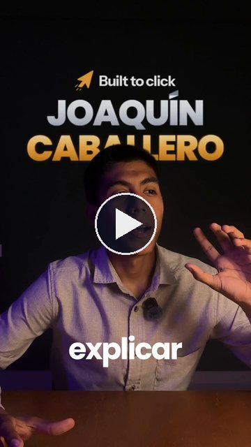
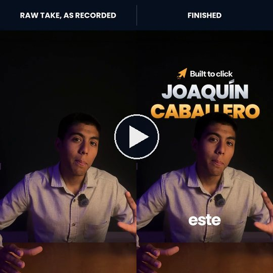
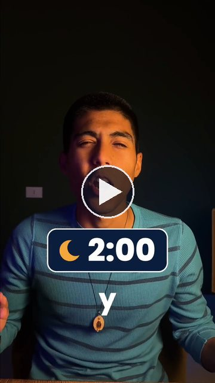
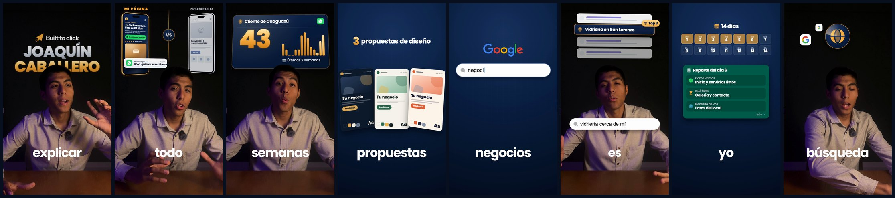
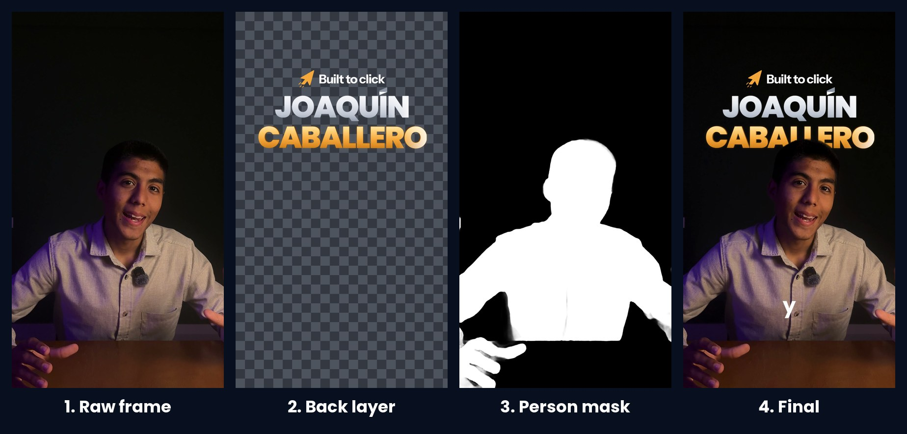
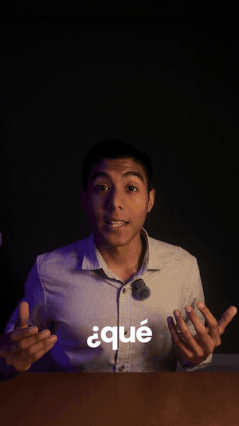
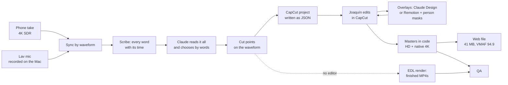

# Video Editing Playbook

How we edit talking-head video with an AI agent and code: ads, a sales video for a landing page, the motion graphics
in 3D, from the raw phone take to the file you upload. With the real videos, the real numbers and the code we ran.

This is how [Built to Click](https://builttoclick.com), a small web agency in Paraguay, edits its own videos.
Joaquín, the founder, records. **Claude** (Anthropic's Claude Code, running on a MacBook) does the work that used to eat
the evenings: getting the files off the phone, syncing the mic, transcribing every word, reading the whole shoot and
choosing the takes, cutting on the waveform, writing the CapCut project, coding the motion graphics, exporting the
masters, compressing for phones, and checking every file before anyone watches it. Joaquín keeps every creative call.

**Start with the docs.** The decisions, the numbers and the mistakes are the part that takes time. **The code is in
[`code/`](code)**, sanitized, if you want to start from it. Text and code are CC0, take anything. The videos are ours:
watch them, do not reuse them ([LICENSE](LICENSE)).

---

## The examples

All of these were edited with what is in this repo. **[Watch them all on one page](https://builttoclick.github.io/video-editing-playbook/)**, with sound.

| | | |
|---|---|---|
|  |  |  |
| **The VSL** (2:23). Recorded in one take of 17:50, pre-edited by code, cut by Joaquín, every graphic coded in React the next morning. [MP4](examples/videos/vsl-v2.mp4) | **Raw vs finished**, the first 10 s, frame for frame. [MP4](examples/videos/raw-vs-final.mp4) | **Three Meta ads** from one shoot, overlays from Claude Design. [V6-01](examples/videos/ad-V6-01.mp4), [V6-03](examples/videos/ad-V6-03.mp4), [V6-04](examples/videos/ad-V6-04.mp4) |

**Joaquín's name in 3D sits behind the head of the person saying it.** Every graphic is rendered as two layers, and a
person mask from Apple Vision cuts the speaker out of the back one, frame by frame ([how](docs/11-motion-graphics-in-code.md)):

What the videos say is in Spanish (Paraguay). Everything here is in English.

---

## What the pipeline does

1. **Record** one long take per block on the phone (4K, SDR) while the lav mic records separately on the Mac, with a
   recorder that does not drop audio. No clap. ([02](docs/02-recording.md))
2. **Sync** the mic to every take by cross-correlating the sound, within 1 ms, drift included. ([03](docs/03-ingest-and-sync.md))
3. **Transcribe** every word with its start and end (ElevenLabs Scribe), and repair the places where it lies about
   time. ([04](docs/04-transcription.md))
4. **Read and choose.** Claude reads the whole timed transcript like a script and picks the best take of every line,
   **by words, never by timecodes**. ([05](docs/05-choosing-takes.md))
5. **Cut on the waveform:** the exact millisecond each phrase starts and ends. ([06](docs/06-cut-points.md))
6. **Write the CapCut project** as JSON: every take a compound clip with 1.5 s handles, the clean mic synced inside,
   captions one word at a time in the house style, banks of takes, markers. Joaquín opens it and edits.
   ([07](docs/07-capcut-pre-edit.md), [08](docs/08-capcut-draft-format.md), [09](docs/09-captions.md))
7. **Overlays,** designed in Claude Design and rendered locally with real alpha ([10](docs/10-overlays-claude-design.md)),
   or **coded** in Remotion with 3D and elements behind the speaker ([11](docs/11-motion-graphics-in-code.md)), placed
   back inside the compounds of Joaquín's own cut.
8. **Sound:** noise reduction when the room allows it, effects tied to events, -14 LUFS. ([12](docs/12-sound.md))
9. **Export** frame-exact masters (HD and native 4K), BT.709 tagged, then a web file that plays well on phones.
   ([14](docs/14-masters-and-web.md))
10. **QA** every file with numbers and contact sheets before anyone watches it, and say what could not be checked.
    ([15](docs/15-qa.md))

When someone wants finished MP4s without opening an editor, steps 4 and 5 end in an edit decision list and code
renders the ads with snap zooms, captions, callouts and sound effects instead ([13](docs/13-finished-render.md)).

## How it fits together

## The rules that matter most

1. **The model never watches the video, it reads it.** A word-level transcript is the map, the waveform gives the
   millisecond, frames are looked at only to decide and to check.
2. **The model picks words, never timecodes.** Code turns words into times. A typed timestamp is a cut in the middle
   of a word.
3. **Never touch the raw files.** No re-encode, no colour change, no move once a project points at them.
4. **Cut on the waveform, relative to the speech level**, with the pads the editor actually uses (40 ms in, 80 ms out).
5. **The last complete takes are usually the best.** People warm up.
6. **Code does the pre-edit, the human does the edit.** Never regenerate a project the human has opened: diff and edit
   in place.
7. **Overlays live inside the take's compound at 00:00**, whole length, so they stay on the words through any re-trim.
8. **Exact frame counts and exact durations everywhere.** Check that frame `i` sits at `i/30`, or audio drifts.
9. **Say BT.709 out loud** on every decode and encode.
10. **Measure every file and say what you could not check.** Claude cannot hear, so the sound always needs human ears.

The long list, one line per mistake we made: [17. Field notes](docs/17-field-notes.md).

## The stack

| Part | What we use | Cost |
|---|---|---|
| Camera | iPhone + Blackmagic Camera app, 4K SDR | free app |
| Mic | DJI Mic Mini into the Mac, a 60-line AVFoundation recorder | hardware |
| Transfer | pymobiledevice3 over USB | free |
| Transcription | ElevenLabs Scribe v2, word timestamps | about US$5 to 6 a month |
| The editor that reads | Claude Code | Claude subscription |
| Human edit | CapCut desktop (projects written by our Python) | free |
| Designed overlays | Claude Design, rendered locally with alpha | Claude subscription |
| Coded motion graphics | Remotion 4 + CSS 3D + Apple Vision person masks | free for teams of up to 3 |
| Everything else | ffmpeg 9, Python (numpy, scipy, OpenCV, Pillow), Node 22 | free |

Versions and setup: [18. Tools and costs](docs/18-tools-and-costs.md).

## Numbers from real runs

- **The VSL:** a 17:50 raw take into a 2:23 video in 21 parts; 466 captions written into the CapCut project by code;
  the motion graphics for all of it coded in one morning in four reviewed batches; HD master 211 MB, native 4K master
  624 MB, web file **41 MB at VMAF 94.9**, all at -14.3 LUFS.
- **The pre-edit of one shoot:** 86 takes chosen (65 ad takes in 3 bank timelines plus one pick for each of the 21
  VSL parts), two CapCut projects with 87 compound clips and 893 captions, every mic offset within 2 ms of the plan.
- **Sync:** within 1 ms per take; the phone and the Mac drift 10 ms every 1000 s.
- **Transcription:** a 44-minute file in 59 s; 21 takes in parallel in 6.5 s.
- **Person masks:** about 10 frames per second on an M1 Pro (1,459 masks in about 2 minutes).
- **A bug the checks caught:** the first 4K master was 0.47 s short (the picture drifting ahead of the voice), with
  every frame present. It would have shipped without a frame-by-frame timestamp check ([14](docs/14-masters-and-web.md)).

## The docs

| # | Doc | |
|---|---|---|
| 1 | [The pipeline, end to end](docs/01-the-pipeline.md) | who does what, the three paths out of one recording |
| 2 | [Recording](docs/02-recording.md) | the camera, the mic recorder that does not drop audio, the room, the script on set |
| 3 | [Ingest and sync](docs/03-ingest-and-sync.md) | off the iPhone over USB, sync by waveform with no clap |
| 4 | [Transcription](docs/04-transcription.md) | Scribe, the call, the cost, the five ways it lies about time |
| 5 | [Choosing takes](docs/05-choosing-takes.md) | the editorial core, written as words |
| 6 | [Cut points](docs/06-cut-points.md) | onset and offset on the waveform, pads, handles, frames |
| 7 | [The CapCut pre-edit](docs/07-capcut-pre-edit.md) | what the project holds, the rules, the Mac sandbox |
| 8 | [The CapCut project format](docs/08-capcut-draft-format.md) | the JSON, object by object |
| 9 | [Captions](docs/09-captions.md) | the house style in pixels, the text rules, safe zones |
| 10 | [Overlays with Claude Design](docs/10-overlays-claude-design.md) | by piece, the content rules, real alpha |
| 11 | [Motion graphics in code: the VSL](docs/11-motion-graphics-in-code.md) | Remotion, 3D, behind the speaker, boards |
| 12 | [Sound](docs/12-sound.md) | noise reduction, effects, levels, loudness |
| 13 | [The finished-render path](docs/13-finished-render.md) | the EDL, zoom grammar, modular ads |
| 14 | [Masters and the web file](docs/14-masters-and-web.md) | frame-exact concat, colour, 211 MB to 41 MB, the player |
| 15 | [QA](docs/15-qa.md) | the checks, the sheets, the human gate |
| 16 | [Ad and VSL craft](docs/16-ads-and-vsl-craft.md) | structure, pacing, measuring hooks, what won |
| 17 | [Field notes](docs/17-field-notes.md) | everything that cost us time, one line each |
| 18 | [Tools and costs](docs/18-tools-and-costs.md) | versions, speeds, setup |
| | [Research](docs/research.md) | the open-source editors and write-ups we learned from |

## The code

| Folder | What |
|---|---|
| [`code/edit-pipeline/`](code/edit-pipeline) | transcribe, pack, render an EDL into finished MP4s, QA, a synthesized sound-effects kit |
| [`code/capcut-pre-edit/`](code/capcut-pre-edit) | sync, transcribe, repair, plan cut points, write and validate a CapCut project, relink for the Mac |
| [`code/vsl-motion/`](code/vsl-motion) | the Remotion project of the VSL, person masks, compositor, masters, placement into CapCut |
| [`code/overlays-claude-design/`](code/overlays-claude-design) | render a Claude Design code bundle with real alpha, unmix a magenta video |

## What is not here

No API keys, no client names, no prices, no account ids, no internal paths. Not our CapCut template projects (they
point at our footage), not third-party logos (`code/vsl-motion/public/` has placeholders), not the raw footage.
The example ads are ones that do not mention a price.

## Related

- [Web Playbook](https://github.com/Builttoclick/web-playbook): how we build fast websites for small businesses.
- [Sales Video Playbook](https://github.com/Builttoclick/sales-video-playbook): how we replaced Loom for personalized
  sales videos.

## License

Text and code: [CC0 1.0](LICENSE), no attribution needed. The videos and images in `examples/`, the Built to Click
name and logo, and Joaquín's face and voice are not part of that dedication: they are here to show the result. See
[LICENSE](LICENSE).
