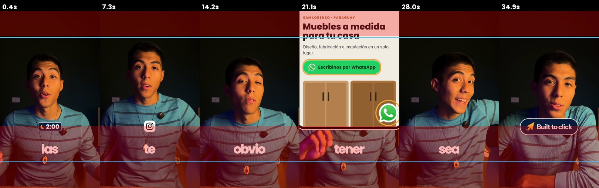

# 9. Captions

Most people watch short-form muted (80 to 85 % in the studies we read), so captions are part of the picture, not an
accessibility extra.

## The house style

**One word at a time. Poppins Bold. White. No outline.**

| | In CapCut | In pixels, on 1080x1920 |
|---|---|---|
| Font | Poppins Bold ("Poppins-Bd") | Poppins Bold |
| Size | 30 | **128 px em** |
| Tracking | -1 (`letter_spacing -0.05`) | **-0.05 em** |
| Position | `transform.y -0.56` | **line box centred at y 1497.6** |
| Colour | white | pure white |
| Outline | none | **none** |
| Animation | "Bounce Out" on a phrase caption with per-word timing | each word pops in from 82 % to 100 % over 90 ms |

The pixel values were measured on a finished ad that Joaquín exported, by matching rendered words against the export
pixel for pixel. That matters because every caption we burn ourselves (previews, the coded masters) must be
indistinguishable from the ones CapCut makes. When one preview came out with a thin outline, the answer was immediate:
"me gustan como estaban, sin el borde ese" (I like them as they were, without that border).

Earlier measurements that are also true, so nobody re-measures them:

- CapCut's caption has a `bold` flag that adds a hairline stroke in the fill colour (`bold_width` 0.008 of the size).
  That is why the same Poppins Bold file looks a little heavier in CapCut than in a plain render. CapCut's cached
  Poppins is byte-identical to the Google Fonts file.
- In libass (ASS subtitles through ffmpeg), sizes are set by line height, not by em: the equivalent of CapCut size 30
  is `Fontsize 211` with `Spacing -6` at PlayRes 1080x1920, centred at `\an5\pos(540,1515)`. Calibrated by rendering
  "entrar" until it measured the same 380 px as on the export.

## The text rules

From the captions Joaquín wrote by hand on earlier ads ([`captions.py`](../code/capcut-pre-edit/captions.py)):

- lowercase; no periods, no commas; opening question marks kept (`¿` and `?`);
- **numbers as digits** ("cuarenta y tres" becomes "43", "catorce días" becomes "14 días", "nueve de cada diez" becomes
  "9 de cada 10");
- brand and place names capitalised (WhatsApp, Google, ChatGPT, the city names), and the brand spelled right even when
  the transcript has it wrong;
- phrases of up to 8 words, a new phrase after any pause of 0.4 s, and a phrase never ends on a word that binds to the
  next one ("de", "que", "para", "mis"...);
- Poppins Bold has **no glyph for the guaraní sign**, so captions print the bare number and designed overlays write
  "Gs.";
- no em dashes on screen, ever.

## Timing

- **Native CapCut captions** (the pre-edit) are written inside each take's compound with per-word times, so they stay
  on the words when the take is re-trimmed. Times are snapped up to the frame from the recognizer's 40 ms grid.
- **Burned captions** (the render path, previews, coded masters): each word shows from its start until the next word
  starts, or for 0.25 s after it ends when the next word is more than 0.6 s away.
- **A caption never survives a cut.** The next word starts right after the cut, so "until the next word" carries the
  last word of a take onto the next shot. Clamp every caption to its piece, and caption a word only if at least 0.1 s
  (or half of it) is inside the cut. Our first QA sheet showed exactly this bug: the last word of the hook sitting on
  the first frame of the body.
- Captions go on **last**, after every overlay, in output time.

## Where captions sit, and an open question

The safe zones for a 1080x1920 frame:

| Placement | Covered by the app's interface |
|---|---|
| Meta Reels **ads** | top 14 % (0 to 270 px), bottom 35 % (1250 to 1920 px), about 6 % on each side |
| Instagram Reels (organic) | top 210 to 250 px, bottom 310 to 450 px, right 84 to 130 px from y 1000 down |
| Feed 4:5 crop of a 9:16 master | only y 285 to 1635 survives |

Our captions sit at about y 1450 to 1546: inside the 4:5 crop, but **inside the bottom 35 % that Meta says the Reels
ad interface can cover**. The best ads ran with them there, so we treat it as a test, not a fix. The QA sheet draws
the zones on every ad ([15](15-qa.md)):

## Engines

- **CapCut native captions** for the pre-edit. Format details in [08](08-capcut-draft-format.md).
- **ASS through libass** in the render path (needs an ffmpeg built with libass).
- **PIL inside the frame pipe** when the ffmpeg build has neither libass nor drawtext (Homebrew's ffmpeg 9 on the Mac
  has neither): draw each word into an RGBA band and composite it over the frame before encoding. That is what the
  VSL masters do ([`export.py`](../code/vsl-motion/tools/export.py)).

Other styles exist in the render tool for other formats: `chunk` (2 or 3 words with the spoken word in an accent colour,
good for fast social) and a plain sentence-case line lower in the frame, which reads better for long-form and Looms.
