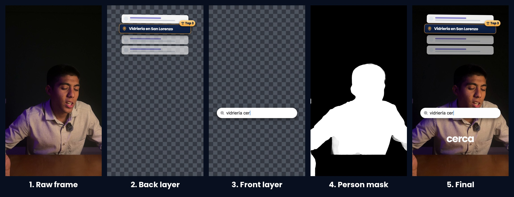
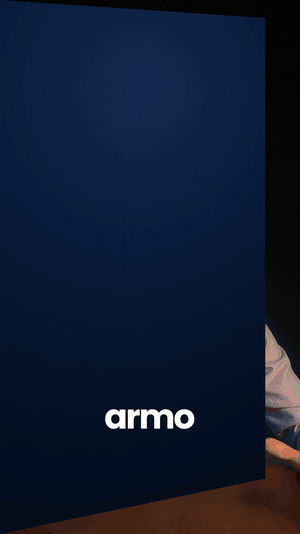

# 11. Motion graphics in code: the VSL

The VSL in [`examples/`](../examples) (2:23, vertical, Spanish) has motion graphics on every second of it: phones in 3D,
a dashboard that counts, three design proposals that flip in and leave inside a WhatsApp bubble, a Google search that
types itself, a 14-day calendar, the form under the video filling itself in. Joaquín's name in huge 3D letters sits
**behind the speaker's head**. All of it is React code rendered to transparent video, timed to the words, and placed back inside
the CapCut timeline Joaquín had cut.

It was built in one morning, in four batches, each one reviewed before the next. Joaquín's reaction to the first batch:
"está muy bueno... me parece una locura que puedas poner cosas atrás de mi cabeza" (it's crazy that you can put things
behind my head).


## Why code and not a generative video tool

We had just taken apart a marketing coach's homepage video that people called "made with AI". It turned out to be
100 % coded interface graphics: a phone ringing, a search bar typing, a map pack, a dashboard, a review, captions, all
razor sharp and in the brand's palette, no generated shot at all. The tell is that every letter and every number is
crisp and on brand.

Generative video (Kling, Veo, Sora and the platforms that bundle them) is good for cinematic B-roll and product shots,
and wrong for this: it garbles text and numbers, and every fix is a new generation. **When a video is mostly interface,
text and numbers, it is code.**

## The stack

| Part | Tool |
|---|---|
| Scenes | [Remotion](https://www.remotion.dev) 4 (React to video), plain CSS 3D, Poppins from `@fontsource`, icons from Iconify (Solar) |
| Timing | the caption words of Joaquín's own CapCut timeline |
| Behind the speaker | Apple Vision person segmentation, a 60-line Swift tool |
| Compositing | Python, numpy, OpenCV, ffmpeg (ProRes 4444 with alpha) |
| Placement | a script that writes the overlay into each compound of the CapCut project |
| Masters | ffmpeg, from the same data ([14](14-masters-and-web.md)) |

Remotion is free for individuals and for companies of up to three people (check its licence for yours).

The whole project is in [`code/vsl-motion/`](../code/vsl-motion).

## 1. The data comes from the edit, not from the script

Joaquín cut the VSL in CapCut from the pre-edit ([07](07-capcut-pre-edit.md)): 21 parts, each a compound, captions
corrected by hand. [`parts_from_capcut.py`](../code/vsl-motion/tools/parts_from_capcut.py) reads that timeline (read
only) and writes `parts.json`, one entry per part:

```json
{"id": "P4b", "dur": 11.4, "frames": 342, "raw_start": 654.5, "wav_start": 2711.070954,
 "win": [1.633333, 9.833333], "timeline": [58.933333, 67.133333],
 "segs": [{"win": [1.633333, 9.833333], "timeline": [58.933333, 67.133333]}],
 "words": [{"w": "yo", "t0": 1.687, "t1": 1.827}, {"w": "sí", "t0": 1.907, "t1": 2.007}, "..."]}
```

`win` is the part of the compound that is visible in the cut, `words` are the edited captions in compound time. A part
split to drop a pause appears once with two `segs` (one compound, one overlay, two visible windows). After a re-trim or a
caption fix, run the script again and every animation moves with the words.

## 2. Every cue is a word

```ts
// Word onset in compound seconds. Visuals land LEAD seconds before the word: the eye reads it as "on the word".
export const LEAD = 0.07;
export const cue = (id: string, i: number, extra = 0) => part(id).words[i].t0 - LEAD + extra;

// from the closing part (P8a): the board swings in on "formulario", the arrows show on "acá abajo"
const bIn = sp(t, cue(ID, 20, -0.15), { damping: 18, stiffness: 120 }); // "formulario"
const arrows = ramp(t, cue(ID, 13, -0.1), cue(ID, 13, 0.2)) * (1 - ramp(t, cue(ID, 25, 0), cue(ID, 25, 0.4)));
```

There is not a single hand-typed second in any scene. `sp()` is a Remotion spring that starts at a given second, with
three presets (soft, snap, lazy); `ramp()` is an eased interpolation. A 70 ms lead reads as exactly on the word.

One object holds the look ([`theme.ts`](../code/vsl-motion/src/theme.ts)): gray for "la página promedio" (the average
page), gold for "mi página", navy surfaces, Poppins, and **one shared camera** (CSS perspective 2200 px with its
vanishing point above the head, where the free wall is), so every 3D object lives in the same space.

## 3. Real 3D with CSS

- **Phones with thickness:** the front face plus 14 rounded slabs stacked behind it, so the edge shows as a solid
  metal side whenever the phone turns ([`Phone3D.tsx`](../code/vsl-motion/src/components/Phone3D.tsx)).
- **Extruded type and numbers:** N copies of the text stepped back in z, the back ones in the side colours
  (`Extrude` in [`Bits.tsx`](../code/vsl-motion/src/components/Bits.tsx)).
- **The gotcha that costs an hour:** `opacity` or `filter` on an element inside a `preserve-3d` chain **flattens it**.
  An extruded number fading out goes flat as it fades. Put fades and blurs on the flat full-frame wrapper that holds
  the perspective (`Obj` in [`base.tsx`](../code/vsl-motion/src/components/base.tsx)), or on every slice (`Extrude fade`).
- **Fonts fail silently in browser renderers.** The root delays the render until Poppins is loaded for a sample string
  with every accented character the script uses.

## 4. Behind the speaker: two layers and a person mask

Every scene renders **twice**: a BACK layer (things on the wall, which the head and hands pass in front of) and a FRONT
layer (things on the chest, on top of everything). A component decides where each element goes:

```tsx
<Layer on="back">  {/* the name, the phones on the wall */}  </Layer>
<Layer on="front"> {/* the chips and the search box on the chest */} </Layer>
```



Then a mask of the person for **every frame** of the take, with Apple Vision
([`personmask.swift`](../code/vsl-motion/tools/personmask.swift)):

```swift
let handler = VNSequenceRequestHandler()          // ONE handler for the whole folder: Vision smooths over time
let req = VNGeneratePersonSegmentationRequest()
req.qualityLevel = .accurate
req.outputPixelFormat = kCVPixelFormatType_OneComponent8
try handler.perform([req], on: img)               // img = one frame; result: an 8-bit mask, 255 = person
```

About 10 frames per second on an M1 Pro (1,459 masks in about 2 minutes), free, local, with clean hair and hands. The
compositor ([`compose.py`](../code/vsl-motion/tools/compose.py)) then does, per frame, in straight alpha and 16 bits:

```
final = FRONT over (BACK x (1 - mask))        mask dilated 5x5 and feathered 1.3 px, so nothing creeps onto the hair
```

and writes ProRes 4444 with alpha, as long as the whole take. A part with nothing on the wall needs no BACK render, a
part that is all board needs no FRONT render: the compositor treats a missing layer as empty.

## 5. Boards: full-screen B-roll inside an overlay

Joaquín's idea from the first review: when a part needs graphic space, "una transición a un board... cubrir toda mi
cara" (a transition to a board, covering my whole face). The board
([`Board.tsx`](../code/vsl-motion/src/components/Board.tsx)) is an opaque navy panel in the FRONT layer that swings in
like a door hinged on the left (`rotateY` from 92 degrees to 0, `transform-origin: 0% 50%`) and swings out hinged on
the right. It shares the stage's perspective and origin, so an object can be swapped from inside the board to a copy
outside it with no visible jump, and ride out over the head while the board swings away. The captions stay on top.



## 6. Continuity across jump cuts

Each part is its own compound, and the cut between two parts is a jump cut. To make a graphic continue across it, each
part exports its drawing as a function of time and of an exit (`Stage(t, exit)`), and the next part starts by drawing
`Stage(PREVIOUS_END)` frozen, then animates the exit. The frozen frame matches the last frame before the cut exactly.

## 7. The rules for this video (from Joaquín's reviews)

- **The average page lives on the right of the screen, "mi página" on the left**, because that is where Joaquín's hands point
  when the average page comes up. Every comparison graphic in our videos follows this now.
- **Less glow on the gold** ("no le pongas tanto glow"): rims and labels soft. One constant controls it.
- **Full-screen boards are welcome** where a part needs room.
- **Preview captions copy the CapCut style exactly** ([09](09-captions.md)), no outline, so the review is honest.
- **Proof is real and anonymous:** numbers re-pulled from the client's analytics, no client name or logo, "Top 3" when
  the average position is about 3 (never "#1").
- **The form on screen copies the real form under the video**, the same labels, typed in the order the words are said,
  so the viewer recognises it the second the video ends.
- **Example data reads high-end.** The first draft filled the form with a glass shop; Joaquín asked for "algo un
  poquito más luxury" and it became a construction company.
- **Every string on screen goes through the copy linter**, the same house rules as any client copy. It caught a
  pronoun construction in a mock page inside a phone.

## 8. QA before every render

Stills over the real frames first ([`render.mjs`](../code/vsl-motion/tools/render.mjs) `stills`, then `compose.py
stills`), as a contact sheet, looked at. What the sheets caught in the first batch alone: labels the head covered
(moved above the phones), a spotlight too high, a chip crossing another, a chat bubble clipping the right edge. Only
then the full render.

## 9. Render

```bash
node tools/render.mjs stills P4b 90,180,245            # QA stills of both layers
node tools/render.mjs video P4b both                   # ProRes 4444 layers, out/layers/
python3 tools/compose.py video P4b                     # + the speaker's silhouette -> out/ENTREGA/P4b.mov
./tools/render_list.sh P4b:both P5a:back P6c:front     # several parts, composites 4 at a time
python3 tools/preview.py                               # the footage + mic + captions + overlays, cut like the timeline
```

- **Remotion's own Chrome hung on the Mac** ("Waiting for root component to load", even for a one-div composition).
  Playwright's `chrome-headless-shell` works: pass it as `browserExecutable` to the renderer API.
- Bundle once, render many: about 1 s to bundle, then every still or video reuses it.
- The first 32 s (5 parts) rendered in about 5 minutes and composited in about 8; with composites in parallel
  (`xargs -P 4`) the numpy step runs about 4x faster.
- Remotion stills of a fully opaque frame come out as RGB PNGs with no alpha channel; the compositor adds alpha 255.

## 10. Back into CapCut

[`place_capcut.py`](../code/vsl-motion/tools/place_capcut.py), with CapCut quit:

1. backs up the whole project by APFS clone, outside CapCut's projects folder;
2. clones each finished overlay into `~/Movies` (the sandbox, [07](07-capcut-pre-edit.md)) as `<part>-motion-vN.mov`,
   a new name for every version;
3. adds an overlay track at 00:00 inside each part's compound, whole length, in every mirror of the timeline and in the
   wrappers, plus the media list entries;
4. validates, and on a re-run replaces the previous version's track.

Joaquín opens the project and the overlays are already inside the cut, on the words, under the captions, and the editing
carries on from there.

## 11. The batches

| Batch | Span of the VSL | What it added |
|---|---|---|
| 1 | 0 to 32.3 s (5 parts) | the name behind the head, the two phones, WhatsApp toasts, the 43 counting up |
| 2 | to 58.9 s | the board, three design proposals, the page building itself, the Google search |
| 3 | to 112.3 s | SEO behind the head, the results stack, people arriving from ChatGPT, the 14-day calendar, the daily report |
| 4 | to 143.4 s | the closing: a 3D question mark, the form typing itself, a global search, the demo and the video analysis |

Then the HD and native 4K masters the same afternoon ([14](14-masters-and-web.md)).

## Reusing this for your own VSL

1. Cut the long take in CapCut into one compound per part, captions fixed.
2. `python3 tools/parts_from_capcut.py "<project>/Timelines/<id>/draft_info.json"` with your part ids in `IDS`.
3. Extract the frames of each part and the masks:
   `ffmpeg -ss <raw_start> -i RAW.MOV -t <dur> -vf fps=30,scale=1080:1920 cache/frames/<id>/f_%05d.jpg`, then
   `tools/personmask cache/frames/<id> cache/masks/<id>`.
4. Write one scene per part, every cue on a word.
5. Stills, look, render, compose, preview, place.
