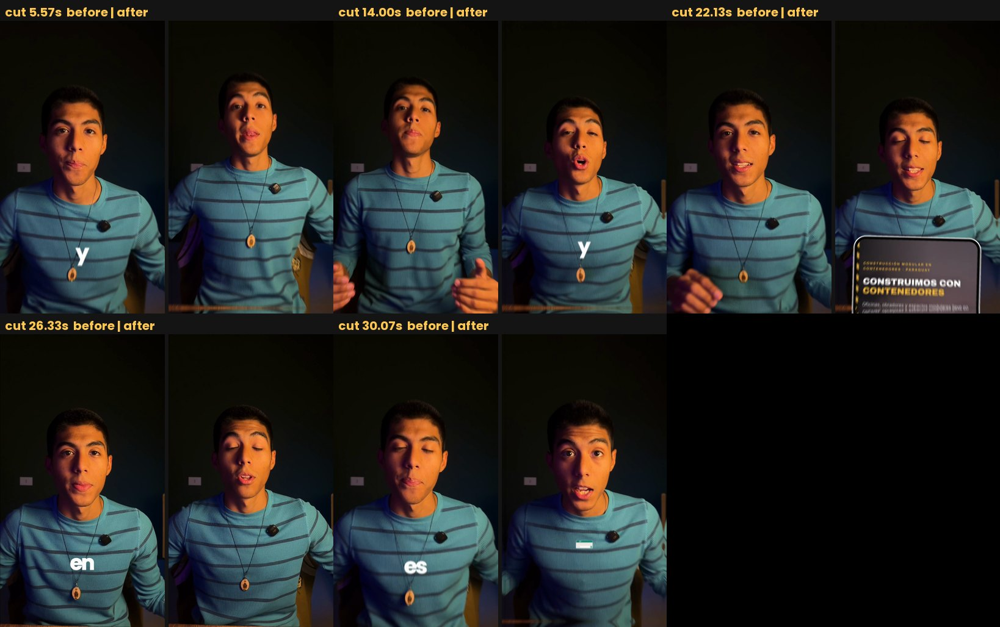

# 15. QA: check every file before anyone watches it

A render does not crash when it is wrong. It ships with a syllable missing, a caption on the wrong shot, a whoosh
louder than the voice, or a picture that drifts half a second ahead of the audio. So every file is **measured** and
**looked at** before it is shown, and what could not be checked is said out loud.

## 1. The automatic check

[`qa.py`](../code/edit-pipeline/scripts/qa.py) on any rendered video:

- duration against the render report (more than 70 ms off means a piece lost frames);
- integrated loudness (-14 +-1 LUFS) and true peak (at most -1.0 dBTP);
- silences over 0.6 s inside the speech (a pause that should have been cut, or a missing word);
- sample jumps at every cut against the local median (a click the fades did not catch);
- `cuts.png`: the frame before and after every cut;
- `safe.png`: six frames with the Reels-ad dead zones in red and the 4:5 crop in blue;
- the level of every sound effect against the speech around it;
- all of it in `qa.json`.

Here is its real output on one of the ads in [`examples/`](../examples), the one Joaquín exported from CapCut
(we gave it the five cut times so it could draw the cut sheet):

```
V6-01.mp4: 35.33s 1080x1920 30fps | -13.2 LUFS, TP 0.1 dBTP | 5 cuts | 0 sfx
ISSUES:
  true peak 0.1 dBTP (> -1.0)
```

The export is slightly loud and its peaks go over full scale: CapCut's export has no limiter. Nothing anyone would
hear on a laptop, and exactly the kind of thing the platforms then turn down or clip. Fix before upload: a limiter or
a loudnorm pass.



## 2. Look at the sheets yourself

Read the images, do not skim them.

- **At every cut:** no flash or black frame; the framing changes (a snap) instead of a near-identical jump; no caption
  or callout from the previous beat still on screen; the face not cut by a zoom.
- **On the safe-zone sheet:** nothing important in the red bands of a Reels ad, nothing important outside the blue 4:5
  lines, no card over the face. Flag the caption position, do not move it on your own ([09](09-captions.md)).
- **A 2 fps contact sheet of the whole video:** captions readable and on the right words, cards on their words,
  push-ins where planned:
  `ffmpeg -i out.mp4 -vf "fps=2,scale=216:384,tile=9x5" -frames:v 1 sheet.png`
- **Overlays over the real take, before rendering the full video** ([11](11-motion-graphics-in-code.md)): labels the
  head covers, elements crossing each other, anything clipped at an edge.

To pull keyframes that are actually readable from an edited video, detect the cut but take the frame 0.7, 1.4 and
2.2 s after it and keep the sharpest (variance of the Laplacian): the frame at the cut itself is mid-transition and
blurred. Sharpness also favours frames with text and interface, which are the ones worth reading.

## 3. Words

Read the caption words in the report against the script: a missing word means a cut point landed inside it; an extra
word means a neighbour take leaked in. Check the numbers and names that are said: Scribe writes numbers as it likes and
mangles brands ([04](04-transcription.md)).

## 4. Masters

For a master that was assembled from pieces ([14](14-masters-and-web.md)):

- frame count, and **every frame at `i/30`** (`ffprobe -show_entries frame=pts_time`), never `-ss` spot checks;
- video and audio durations equal;
- audio offset against the reference at three points (we read 0.00 ms at 5, 60 and 130 s);
- frames against the approved preview, by index (mean difference about 1.8 of 255: the same frames);
- levels unchanged (average luma 54.448 before and after the re-join);
- 4K against HD: the same frames (mean difference 1.7 after scaling);
- colour tags present (`color_space`, `color_transfer`, `color_primaries` all bt709).

## 5. The web file

- VMAF against the master **with both inputs aligned**, mean and 5th percentile, not just the mean;
- loudness unchanged; `moov` before `mdat` (faststart); tags present;
- the CDN answers a range request with **206** and a `content-range` header;
- on the live page at phone size: the right source, `readyState` 4, buffering, a seek near the end, the player's
  behaviour ([14](14-masters-and-web.md)).

## 6. The critic pass, for anything published

Fresh eyes catch what the author stopped seeing. Either re-read the video as a critic after a pause, or give a fresh
agent this brief, with the frames, the cut sheet and the report:

> You are a harsh short-form ad editor. Here is the rendered ad (frames every 0.5 s, the cut sheet, the report JSON
> with every word, cut and sound cue, and the script). Roast it, don't praise it. Give a verdict, then problems ranked
> by how much they cost attention, each with a timecode and the evidence (a frame, a level, a word), then the 5 fixes
> to do first. Watch for: a hook that doesn't land in 1.5 s, a payoff line cut off, a card that arrives before its
> word, text too small at phone size, a sound that isn't tied to anything, the same zoom rhythm for too long, dead air,
> a call to action that is not one clear instruction.

## 7. Limits

- At most three fix-and-render loops. If issues remain, report them instead of looping.
- **Always say what could not be checked.** Claude cannot listen, so the mix, the sound effects and anything about
  "does it sound good" need human ears.

## 8. The human gate

The last check is Joaquín, and the work is shaped so that review is cheap: previews cut exactly like the timeline,
captions in the exact house style, overlays in batches of 30 to 60 seconds of video, each batch reviewed before the next.
That word is the gate: "súper sólido, continúa" means the next batch starts; a note ("menos glow", "la promedio a la
derecha") is applied to everything already made before anything new is added.
