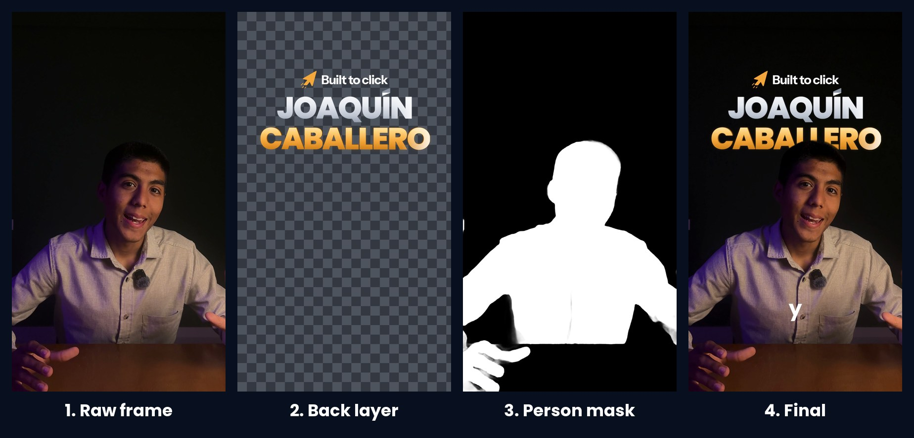
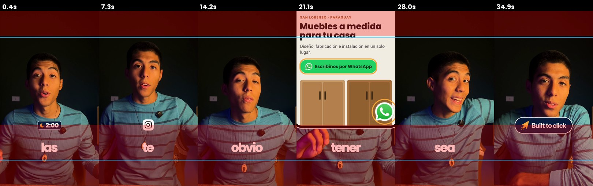
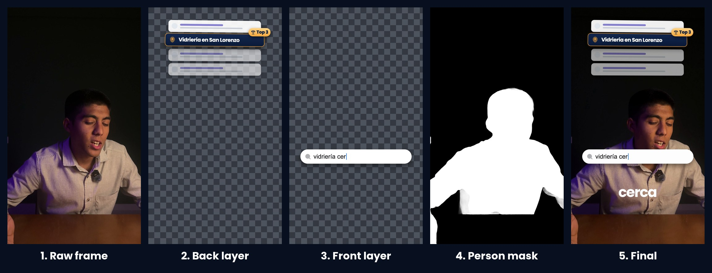

# 21. Coded overlays on a talking head: the ads

[Doc 11](11-motion-graphics-in-code.md) is the machinery: Remotion scenes timed to the words, two layers, an Apple
Vision person mask so the graphics can sit behind the speaker. This doc is what changed when the same machinery went
onto Joaquín's ad takes, and the rules Joaquín's reviews set for it. Two jobs:

| | The ad series (October) | The double (November) |
|---|---|---|
| What | 24 coded pieces of Joaquín's takes (11 hooks, 3 bodies in 9 pieces, 4 closers) that make 37 ads | one ad script recorded by Joaquín playing both sides, with the chat film's graphics on the wall behind the head |
| The cut | Joaquín's own, in CapCut, from the pre-edit ([07](07-capcut-pre-edit.md)) | an EDL rendered by code ([13](13-finished-render.md)) |
| Overlays | placed back inside each compound of the CapCut project ([11](11-motion-graphics-in-code.md)) | composited in code over the cut |
| The file | every ad joined frame-exact in code | the whole film in code, voice and effects mixed |
| Code | [`code/meta-export/`](../code/meta-export) | [`code/talking-head-double/`](../code/talking-head-double) |



## Joaquín's rules for overlays on the ads

Dictated after watching the first overlays of an ad series inside CapCut, then sharpened on every review since. They
hold for designed overlays ([10](10-overlays-claude-design.md)) and coded ones alike.

1. **No client logo and no company name on screen, and only that is hidden.** No business name in text, no logo, no
   name inside a chat ("Hola, quiero una cotización", hi, I'd like a quote; never "Hola" plus the business name). A
   client's screenshot is fine with the navbar cropped off and the name blurred where it appears. Anything that
   carries the name (a ChatGPT answer, a Google result) gets the name covered.
2. **A search is shown as a search:** the search bar with the query typing itself, never a results page or a client's
   result. ChatGPT the same: the box with the question typing.
3. **A generic site for generic lines.** A client appears once, in its own case. When the line talks about "a website",
   the site on screen is generic and has no brand. Building every ad on one client's site "se me hace tonto" (seems
   silly to me).
4. **Raw phone captures straight over the video,** cut off at the bottom if they must be, with the thing that matters
   (the contact button, the floating WhatsApp bubble) pointed at or enlarged. A real capture may cover the face for a
   moment when it needs the room: "está bien tapar la cara, pero no exagerar" (covering the face is fine, but don't
   overdo it). A generic element (a chat, a message, a chip) goes in the free zones, never as a big card over the face.
5. **When something needs most of the frame, it is a real full-screen B-roll:** an opaque brand backdrop edge to edge,
   captions still on top, never a big card with Joaquín peeking around it. "Que sea un B-roll bien hecho" (make it a
   well-made B-roll). A big capture of a website is a full-screen B-roll by default.
6. **Whatever overlaps Joaquín goes behind Joaquín, through the person mask.** "No pasa nada si va detrás de mí, eso es
   lo que quiero" (it's fine if it goes behind me, that's what I want). The search box, a call banner, the chips and
   checks above the head live on the BACK layer. In front only what sits on the shirt (chest chips), a chevron beside
   the captions, and a full-screen B-roll. A BACK element may overlap the hair: the mask cuts it out.
7. **The captions are never covered:** "que no se estampen las captions" (don't stamp anything on the captions).
8. **Less glow:** "no le pongas tanto brillo a todo" (don't put so much shine on everything). No drop-shadow glow, no
   sheen sweeping across the gold, a flatter gold gradient.
9. **More words and more cards** on the lines, more detail in every element: an overlay that only repeats the caption
   is wasted.
10. **Captions a bit bolder** than Poppins Bold once rendered: ExtraBold (800).
11. **Comparisons:** ours on the left, the average one on the right, where Joaquín's hands point ([11](11-motion-graphics-in-code.md)).

## The frame: Meta's 4:5 band and where Joaquín sits

A 9:16 ad also runs as a 4:5 feed placement, and Meta crops the 1080x1920 master to **y 285 to 1635**. Anything outside
that band is gone in the feed: every overlay, card, price, arrow, chip and caption lives inside it, and so does the
content of a full-screen B-roll ([09](09-captions.md) has the Reels dead zones too).



Measured on the person masks of the ad series (Joaquín seated, the phone on a tripod):

- **Top of the head at y 580 to 640**, the head between x 360 and 760.
- **Captions on y 1420 to 1580** (one word at a time, line centre y 1497.6).
- That leaves the wall above the head (y 285 to about 580) and the two side columns (centres x 205 and 875) as the free
  zones; anything there that the head or a hand crosses goes on the BACK layer, and the mask cuts it.

The double was framed wider (a desk shot): hair top at about y 800, head x 480 to 660, shoulders from y 1080, the desk
from y 1380. There the wall (y 150 to 800) took the chat and the big moments, the chest band (about y 1255) took the
compose bar and the chips, and the captions sat at y 1515.

QA before Joaquín sees anything: a contact sheet of the moments with the 4:5 box drawn, and the same moments cropped
`crop=1080:1350:0:285` ([15](15-qa.md)).

## The double, all in code

The script "Ya sé tus preguntas" (I already know your questions) has a client asking the usual questions in WhatsApp
and getting the answers. The chat film ([20](20-animated-films.md)) shows it as the viewer's phone; the double is
Joaquín playing both sides in one take, with the same chat on the wall behind the head. Joaquín's ask: when the
other person talks, "como un mirror para que se dé cuenta que es otra persona, o que cambie de color" (like a mirror
so you notice it's another person, or a change of colour). Joaquín's verdict on the first draft: "me gusta muchísimo
cómo se ve todo" (I really like how everything looks).



1. **Cut.** The take transcribed, an EDL by source times with a `beat` per line (Q for the client, A for Joaquín) and
   two appended clips (the "seen" gag and the end card cut from the chat film), rendered by the
   [edit pipeline](../code/edit-pipeline) into a cut, a voice track and a report of every piece.
2. **Timeline.** [`th_pieces.py`](../code/talking-head-double/tools/th_pieces.py) turns the report and the transcript
   into `th.json`: every piece with its role and every word it keeps, in output frames.
3. **Cues on words.** [`th_cues.json`](../code/talking-head-double/src/data/th_cues.json) holds every cue as
   `{beat, word, off}`: the frame of a spoken word plus an offset. The picture ([`TH.tsx`](../code/talking-head-double/src/TH.tsx))
   and the sound ([`th_sound.py`](../code/talking-head-double/tools/th_sound.py)) read the same file. A beat can span
   several pieces (the tightener splits a long breath), so a word is searched in all of them, and a word that is not
   there falls back to a couple of frames into the beat, so a retake never breaks the film.
4. **Layers.** `node tools/render.mjs layers` renders the BACK layer (the chat stacking up on the wall, the price in gold
   3D, the page that writes itself, the 14 days) and the FRONT layer (the client's quote on a sticker, the chips, the
   compose bar on the chest, the puff, the captions) as ProRes 4444 with alpha.
5. **Compose.** [`th_compose.py`](../code/talking-head-double/tools/th_compose.py), frame by frame: the client's pieces
   flipped and cooled (RGB x 0.86 / 1.0 / 1.14, then x 0.92, so the change reads on a phone); BACK over the footage
   with its alpha cut by the person mask (dilated 5x5, feathered 1.3 px); a snap zoom of 1.08 about the face on every
   second piece of Joaquín's, footage and wall together; FRONT on top, unzoomed.
6. **Sound.** Joaquín's voice from the cut plus effects under it, each role set so many dB under Joaquín's median 50 ms
   speech level (a WhatsApp ding 9 dB under, a key 18 dB under, a tick 21 dB under), then -14 LUFS and a true-peak
   limiter at -1.5 dBTP. Details in [19](19-sound-effects.md).

**Captions in the overlay.** Our Mac's ffmpeg 9 (Homebrew) had no libass, so the renderer could not burn the captions.
They are drawn in the FRONT layer from the word times instead: one word, Poppins, a 3-frame pop from 0.86, y 1515; a
word holds until the next one if that is less than 0.35 s away, else 0.15 s past its end, never past its cut. The same
ffmpeg had no zscale for the iPhone's HLG footage; Apple's own tone map through VideoToolbox does it with nothing
installed:

```bash
ffmpeg -hwaccel videotoolbox -hwaccel_output_format videotoolbox_vld -noautorotate -i take.MOV \
  -vf "scale_vt=color_matrix=bt709:color_primaries=bt709:color_transfer=bt709,hwdownload,format=p010le,transpose=2,scale=1080:1920" ...
```

`hwdownload` accepts only `p010le` for 10-bit frames, and the hardware path ignores the rotation tag, so a phone file
with rotation 90 needs the `transpose=2` (checked on frames).

## The cut, as Joaquín wants it

Joaquín's notes on the first fully coded talking-head edit, now our defaults for the next ones:

- **Tighter than the renderer's defaults:** "los cortes de las palabras creo que podés achicar un poquito más" (I think
  you can tighten the word cuts a little more). Pads 0.04 s in and 0.06 s out (defaults 0.06 and 0.09); the pause
  tightener keeps gaps over 0.32 s down to 0.11 s (defaults 0.45 and 0.16). In a list ("what it includes") tighter
  still: gap 0.22, keep 0.08.
- **Per-join pads where the room is heard.** On the second draft Joaquín named three joins where one sentence ran into
  the next take with too much air: `pad_in` / `pad_out` of 0.02 s on those segments only.
- **A join is a snap, never a drift.** A 1.07 push released after each cut read as the picture sliding sideways after
  the transition. The cut is instant and the zoom is a level change at the cut, 1.0 and 1.08 alternating
  ([06](06-cut-points.md)).
- **The stutter that was not the edit.** "Veo como un frame y después cambia otra vez el movimiento" (I see a frame
  and then the movement changes again). The cut, made of pieces copied with `-c copy`, carried a one-frame timestamp
  hole at five joins; ffmpeg's default constant-rate decode filled each with a duplicated frame, and the compositor and
  the mask extraction both swallowed them: a stutter at those joins and the picture up to 5 frames late against the
  voice by the end. Read a concatenated cut with **`-fps_mode passthrough`**, always, and check with
  `ffmpeg -i base.mkv -f null -` (the `dup=` count must be 0).
- **A gag can erase the speaker.** The client's last line haggles, and the answer is silence: the "seen" gag. Joaquín's
  ask: "que yo aparezca y luego aparece un puff y yo desaparezco, y que se escuche el puff" (I appear, then a puff
  appears and I disappear, and you hear the puff), with a little more room after the line first (`pad_out` 0.22).
  [`th_plate.py`](../code/talking-head-double/tools/th_plate.py) makes the empty chair: one frame of the take, the
  Apple Vision mask grown 28 px (hair, the microphone, the shadow on the desk), LaMa inpainting at full 1080x1920
  (both sides multiples of 8), pasted back with `max(mask, blur(mask))`; then a 1.5 s clip of that plate with a slow
  1.0 to 1.025 push and the take's own room tone, appended to the EDL. On screen: 0.8 s of Joaquín, a cartoon cloud of
  soft discs blooming from the chest and drifting up and out, the plate under it, and when the smoke thins the chair
  is empty while the ticks on the wall turn blue with one dry knock. The puff's sound is a fast whoosh peaking on the
  cloud's fullest frame.
- **A gag beat needs a close-up and a sound.** The same lesson as the chat film's lens ([20](20-animated-films.md)).

## Cut on the waveform, never on the transcript

Joaquín's words: "fijate en la forma del audio... cuando termino yo de decir una palabra, cuando ahí baja la curva en el
audio, corte ahí. No te fijes solamente en los timestamps" (look at the shape of the audio; when I finish a word and
the curve drops, cut there; don't look only at the timestamps). Measured on 24 of Joaquín's own trims:

- **In-point:** the first frame of the word, 0 to 2 frames after the sound starts.
- **Out-point:** a median **22 dB under the last word's peak**, about **70 ms before the tail reaches the room tone**.

Transcript times drift 50 to 100 ms, so an edge taken from them cuts words or leaves air. How to find these edges in
code (the sustain check, the high band for a final "s", the clip's own floor): [06](06-cut-points.md).

## Export to Meta

[`export_ads.py`](../code/meta-export/export_ads.py) made the 37 ads of the series from 24 pieces:

- **Pieces once, ads many.** Each piece is rendered once: the footage on Joaquín's trim, the overlay, the captions, to
  ProRes 4444, and its audio (Joaquín's mic at the volume set in CapCut) as raw float. Every ad after that only reads
  ProRes and writes H.264. All 37 in about 10 minutes.
- **Frame-exact joins.** A piece has exactly `round(duration x 30)` frames and exactly that many frames' worth of audio
  samples, with a 4 ms fade at each end. An ad is its pieces back to back, so nothing can drift; `export_ads.py check`
  proves it (the frame count, and every frame's timestamp within 1 ms of `i / 30`).
- **The transition, rebuilt as a push-in.** Joaquín's hand edits used CapCut's "Pull in" at the hook to body and body to
  closer joins. In code: the last 5 frames before the cut push in to 1.22 (eased in) with a short zoom blur, the first
  5 after it come out of 1.22, and a whoosh starts half a transition before the cut. Cuts inside a body stay hard: the
  overlays carry across them.
- **Meta-ready.** No edit list (negative CTS offsets keep frame 0 at t=0 without one), BT.709 written into the H.264
  stream (ffmpeg 9 takes the colour tags from the frames: `setparams` is what makes them stick), moov first.
  [`meta_ready.py`](../code/meta-export/meta_ready.py) does the same for any file without re-encoding: our first 37
  exports had two edit lists and untagged colour, and it rewrote them with the frames bit-identical. Upload 1080 wide
  ([14](14-masters-and-web.md) has what Meta does with the file after that).
- **The AAC priming.** With no edit list, the encoder's priming samples play: Apple's `aac_at` writes 2112 (44 ms at
  48 kHz), so every sound lands 44 ms late. The fix in our sound scripts is to trim them before the encoder
  (`-af atrim=start_sample=2112`). On another chain we kept every sample instead: the picture holds its first frame for
  2 extra frames and the mix gets a 1088-sample pad (3200 minus 2112), which puts the audio exactly on its frame. Either
  way, measure once by cross-correlating the decoded file with the mix, never by ear ([19](19-sound-effects.md)).

## Numbers

- **The ad series:** 24 pieces, 37 ads, every one checked for frames, timestamps and loudness; Joaquín's levels kept as
  set, only a peak limiter at -1 dBFS. Re-rendering all 24 overlays took about 12 minutes; exporting all 37 ads about 10.
- **The double, third draft:** 43.4 s; 88 effects, every one under the voice (tightest margin +11.5 dB); -14.0 LUFS and
  -1.5 dBTP; earshot's critique 21 of 23 metrics in range (the one flag left: no music, by design); 72 % of cues within
  one frame and 97 % within 100 ms (under a voice the onset detector also reads the consonants); no duplicated frame
  after any join.
- **Person masks:** about 10 frames per second on an M1 Pro ([11](11-motion-graphics-in-code.md)).
